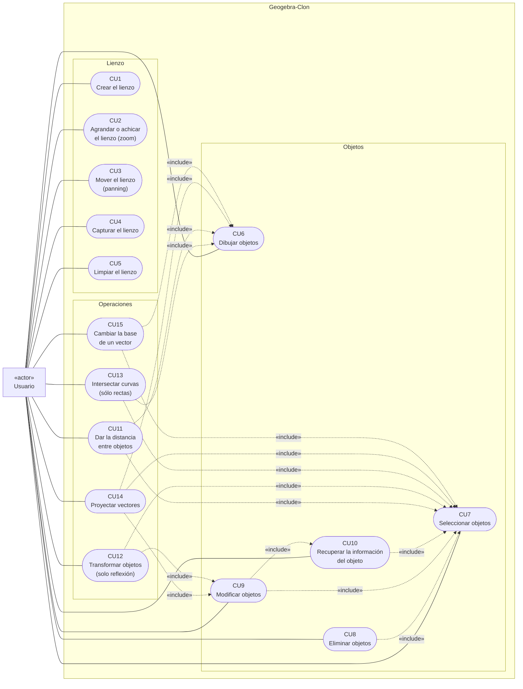

# Diagrama de Casos de Uso — «Geogebra-Clon»

> Observaciones
> - Como se había indicado en el README, todos los CUs tienen al caso no. 1 («Crear el lienzo») como precondición; sin embargo, en el diagrama adjunto se omitió la relación por motivos de legibilidad.
> - Parecido al caso anterior, para que algunos casos de uso tengan sentido (selección, modifcar, [...], eliminar) tiene que haber, previamente, objetos en el plano; en este sentido, el CU no. 6 es también una precondición para otros CUs, no obstante, por cuestiones también de legibilidad ésta relación fue obviada del diagrama (en el README figura como precondición de algunos CUs).

---

