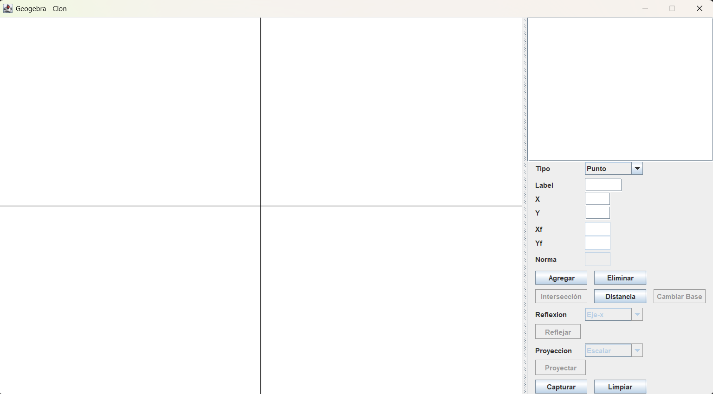
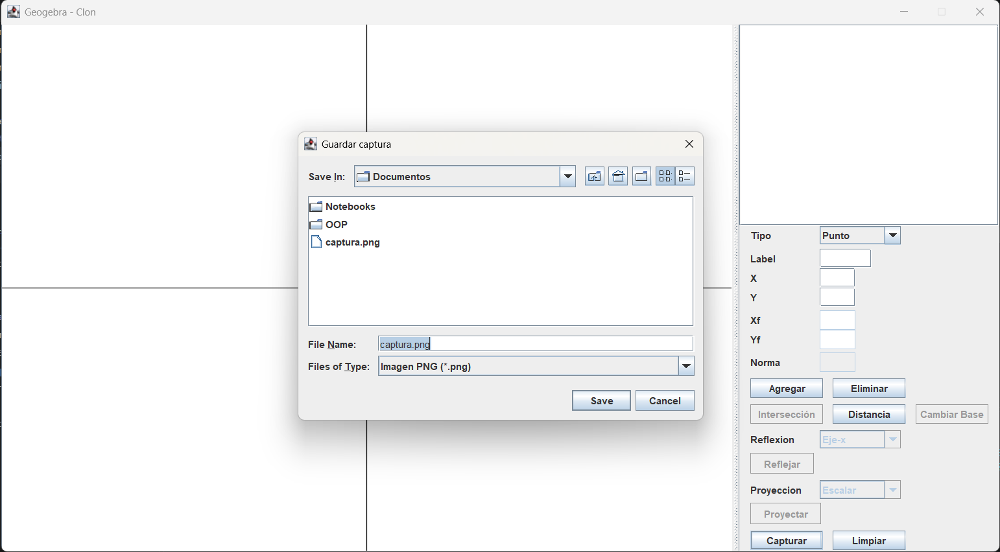

# Geogebra-Clon

## Idea

Ofrecer un graficador (símil 1ra ver. del Geogebra) de rectas, vectores y puntos que sea capaz de manejar algunas operaciones que los involucren (por ej.: cambio de base, proyecciones, reflexiones, medición de distancias, ..., intersecciones).

Como los objetos a tratar son lineales y, con excepción de las rectas, homogéneos; las operaciones previamente enumeradas pueden resolverse de la siguiente manera:

1. La intersección:
    - (si la hay y no es infinita) vendría de calcular el kernel (o núcleo) de una transformación (de matriz 2x3), cuya proyección central (si es posible, esto es: tercer componente del vector que genera el kernel != 0) da la solución (una tupla que representa un punto, el de intersección). 
    - (si la intersección es también una recta) las triplas de la matriz de 2x3 serían L.D. (una se puede escribir en términos de la otra).
    - (si no la hay) El tercer componente del vector que genera el kernel es igual a 0 y los vectores de la matriz son LI (de modo que el kernel tiene dim. = 1).
2. Las proyecciones son productos internos.
3. El cambio de base es una transformación lineal.
4. Para calcular la menor distancia, dado que los objetos viven en $`\mathbb{R}^2`$:
    - Si se sabe que hay intersección -> $`dist(L_1, L_2) = 0`$
    - De no haberla, siempre y cuando se trate de rectas, la menor distancia va a estar dada por la longitud del segmento que tiene por extremos un punto de la $`L_1`$ y otro de la $`L_2`$, donde tales puntos pertenecen a una recta que es perpendicular a ambas (dado que: $`L_1 \parallel L_2 \iff L_1 \cap L_2 = \emptyset \quad \forall: \ L_1, L_2 \subset \mathbb{R}^2`$).
    - La menor distancia entre un punto y una recta ($`dist(P_1, L)`$) es semejante a calcular la distancia entre dos rectas (en este caso el punto $`P_1`$ sería el punto de paso para una recta L' que es paralela a L), de modo que: $`dist(P_1, L) = dist(L', L)`$, donde $`L': \lambda \cdot \vec{v_1} + P_1`$ 
5. La longitud de los segmentos y de los vectores está dada por la norma 2 (euclídea) de la diferencia de los puntos que las describen ($`\lVert P_1 - P_2 \lVert_2`$).
6. Las transformaciones (rotaciones, reflexión, …, etc.) respecto del origen, así como de los ejes del plano (x e y), se pueden implementar como matrices de 2x2; si se mueve el origen a otro punto se va a requerir de matrices de 3x3 (ya que la homogeneización de coordenadas sería necesaria).

> Para más información: léase la sección [Intuición](Documentos/geometría.md)

## Casos de Uso - CUs

> Secuencias: [Ver](Documentos/diagramas-secuencia.md)

1. Crear el lienzo. x
    - Postcondition: Se creó el lienzo.
2. Agrandar o achicar el lienzo (zoom in/out). x
    - Precondition: (ref. caso no. 1) y el usuario giró la rueda del mouse (o acción equivalente).
    - Postcondition: Se redimensionó el lienzo.
3. Mover el lienzo (panning). x
    - Precondition: (ref. caso no. 1) y el usuario desplazó el mouse luego de haber hecho click izquierdo (o acciones equivalentes).
    - Postcondition: Se movió el lienzo.
4. Capturar el lienzo. x
    - Precondition: (ref. caso no. 1), el usuario seleccionó el botón «Capturar» y definió la ruta en donde guardar la captura.
    - Postcondition: Se guardó la captura en el directorio dado.
5. Limpiar el lienzo. x
    - Precondition: (ref. caso no. 1), se hizo click en el botón «Limpiar» y se confirmó la acción en el pop up (o modal).
    - Postcondition: Se eliminaron todos los objetos en el plano y se reiniciaron los índices de los contadores.
6. Dibujar objetos. x
    - Precondition: (ref. caso no. 1), el usuario seleccionó el tipo de objeto, completo los campos pertinentes e hizo submit de esa información (se clickeó el botón «Agregar»).
    - Postcondition: Se agregó un objeto en el panel lateral y se dibujó la figura especificada.
7. Seleccionar objetos. x
    - Precondition: (ref. caso no. 1) y se crearon objetos en el plano (ref. caso no. 6).
    - Postcondition: Se seleccionó el objeto y se habilitaron los campos pertinentes para esa clase de objetos.
8. Eliminar objetos. x
    - Precondition: (ref. casos no. 1 y 6), se seleccionó el objeto (ref. caso no. 7) y se hizo click en el botón «Eliminar».
    - Postcondition: Se eliminó el objeto seleccionado.
9. Modificar objetos. x
    - Precondition: Se seleccionó un objeto existente (ref. caso no. 7), se modificaron los campos pertinentes y se hizo submit de esa información (click en el botón «Agregar»)
    - Postcondition: Se modificó el objeto seleccionado. 
10. Recuperar la información del objeto. x
    - Precondition: Se seleccionó un objeto existente (ref. caso no. 7).
    - Postcondition: Se devolvió la información actualizada de ese objeto.
11. Dar la distancia entre objetos. x
    - Precondition: Se seleccionaron dos objetos (ref. caso no. 7) en alguna de las siguientes combinaciones: 1) Punto-Punto, 2) Recta-Recta, o 3) Vector-Vector; y eventualmente se seleccionó el botón «Distancia».
    - Postcondition: Se dibujó en el plano un nuevo segmento cuya norma es la distancia entre los objetos dados (combinaciones no. 1 y 2); o se dibujó un vector (combinación no. 3).
12. Transformar objetos. x* (sólo reflexión)
    - Precondition: Se seleccionó un objeto (ref. caso no. 7), que puede tratarse de un vector o una recta, se especificó el tipo de transformación y se hizo el submit (a través de haber clickeado en «Reflejar»).
    - Postcondition: Se modificó el objeto seleccionado (ref. caso no. 9) según lo especificado por la transformación seleccionada.
13. Intersectar curvas. x* (sólo rectas)
    - Precondition: Se seleccionaron dos rectas (ref. caso no. 7) y se hizo click en el botón de leyenda «Intersección».
    - Postcondition: Se dibujó un punto que señala la intersección (si la hay) (ref. caso no. 6).
14. Proyectar vectores. x
    - Precondition: Se seleccionaron dos vectores (ref. caso no. 7), se especificó el tipo de proyección: 1) escalar o 2) vectorial; y se hizo click en el botón «Proyectar».
    - Postcondition: Se dibujó (ref. caso no. 6) un: 
        - caso no. 1) Segmento cuya magnitud representa la coordenada de la proyección escalar de un vector a sobre vector b; 
        - o caso no. 2) Vector que representa la proyección vectorial del vector a sobre b. 
15. Cambiar la base de un vector. x
    - Precondition: Se seleccionaron tres vectores (ref. caso no. 7), de los cuales uno es el vector a escribir en términos de la nueva base y los dos restantes la nueva base vectorial; y luego se hizo click en el botón «Cambiar Base».
    - Postcondition: Se dibujó un nuevo vector (ref. caso no. 6) escrito en términos de la base proporcionada.

> Estado: (x) caso de uso implementado; (x*) caso de uso implementado parcialmente 

## Detalles de la Solución

1. Cantidad de Clases: 15 [(Ver)](Documentos/diagrama-clases.md)

   Desambiguación:

    - Modelo: ObjetoGeo, ObjetoLineal, Punto, Recta, Segmento, VectorGeo, GestorObjetos, Curva, ModeloListener. (9 clases)
    - Controlador (monolítico - 1 clase)
    - Vista: VistaPrincipal, Lienzo, PanelControles y Transformación. (4 clases)

    ∴ 14 clases MVC + 1 clase «ExportadorImagen» para escribir en el disco.
    -> 15 clases totales, de las cuales 2 son abstractas y otro par representan interfaces -> 4 puntos de extensibilidad.

2. PLUS: Paquete Matriz y Excepciones propias («ExcepcionGeometrica» ← «ExcepcionBaseLD», «ExcepcionDistanciaCero», «InterseccionDistintaAPunto»).

3. GoF Patterns: Observer - implementado para notificar a la vista de los cambios en el modelo, que hace un "push from below".

4. Interfaces gráficas (pantallas): 2 - 1. Principal (lienzo + panel lateral de herramientas/controles) y 2. Para seleccionar la ruta en donde guardar la captura de pantalla.

Pantalla no. 1:

Pantalla no. 2:

## Intuición

[Intuición](Documentos/geometría.md)
